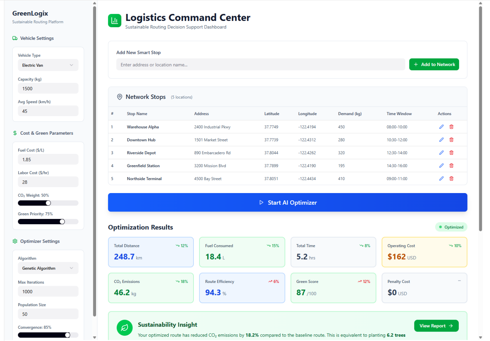
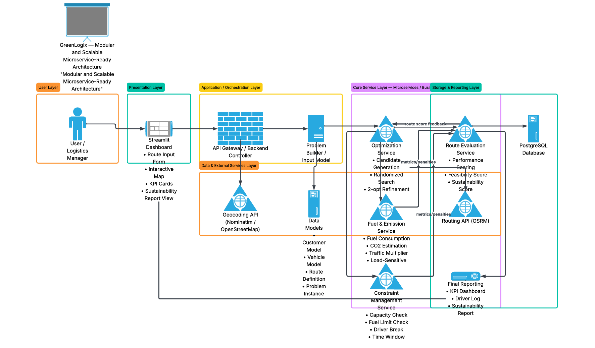
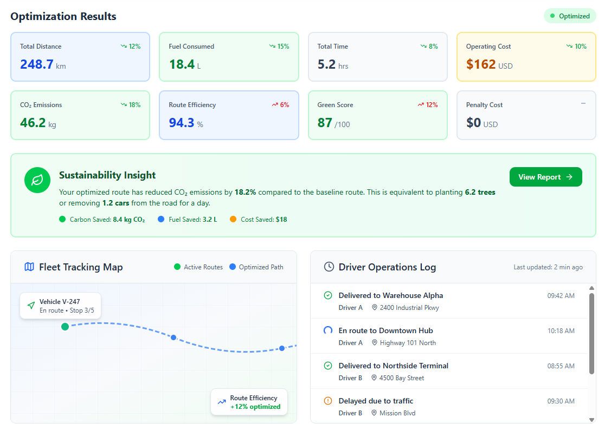
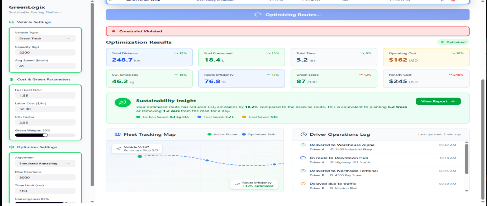

# 🌍 GreenLogix: Sustainable Vehicle Routing & Decision Support System

## 📌 Project Overview
GreenLogix is an engineering solution and decision support dashboard designed to optimize delivery routes by balancing operational efficiency, economic cost, environmental sustainability, and legal constraints. Developed as a technical product, it addresses the Vehicle Routing Problem (VRP) under modern urban logistics conditions.

**Authors:** Satı Sıla Yolcu, Gökberk Kaan Tapan, Merve Kızılırmak

📄 **Full project report:** [GreenLogix_Report.pdf](docs/GreenLogix_Report.pdf) (SE456 Project-1 — problem formulation, literature review, design, and experimental validation)



## 🎯 Core Objectives & SDG Alignment
The project bridges the gap between advanced optimization methods and real-world delivery constraints. It is directly aligned with the United Nations Sustainable Development Goals:
* **SDG 11 (Sustainable Cities and Communities):** Reduces unnecessary vehicle mileage and urban air pollution to support more planned movement of delivery fleets.
* **SDG 13 (Climate Action):** Integrates climate change measures by treating fuel consumption and estimated CO2 emissions as primary components of the route-determining stages.

## 🏗️ System Architecture & Technologies
GreenLogix features a modular, microservice-ready architecture separating data representation, fuel modeling, constraint validation, and optimization.
* **Core Implementation:** Python is utilized for rapid prototyping and mathematical implementation.
* **Dashboard Interface:** Streamlit provides an interactive logistics command center for route input and KPI visualization.
* **Mapping & Visualization:** Folium is used for interactive route, depot, and stop visualization on the map.
* **External APIs:** The system relies on Nominatim/OpenStreetMap for geocoding and OSRM for realistic route geometry and travel estimation.
* **Database Layer:** PostgreSQL is designed to handle the data model layer within the architecture.



The architecture is organized into six components: the **User Interface Layer** (Streamlit dashboard), the **Input & Data Modeling Layer** (customers, vehicles, problem instances), the **Fuel & Sustainability Engine**, the **Constraint Management Layer**, the **Optimization Engine**, and the **Visualization & Reporting Layer**.

## ⚙️ Optimization & Mathematical Model
Rather than treating routing as a pure shortest-path problem, GreenLogix evaluates candidate routes as a multi-factor engineering decision problem.
* **Algorithm:** The optimization engine utilizes Simulated Annealing, supplemented by 2-opt refinement and randomized search.
* **Load-Sensitive Fuel Model:** Fuel consumption is dynamically calculated based on the vehicle's baseline fuel rate, distance traveled, a load sensitivity coefficient (remaining cargo), and traffic factors.
* **Scoring Function:** The final route score is a weighted combination of total distance, total fuel consumption, CO2 emissions, and operational penalties.
* **Constraint Management:** The system rigorously evaluates routes against vehicle capacity, fuel availability, and continuous driving duration limits to ensure operational feasibility.

## 🖥️ Decision Support Dashboard
The dashboard is designed as a decision support interface rather than a simple route viewer. Vehicle settings,
cost & green parameters, and optimizer settings sit in the sidebar, while the main area focuses on route outputs:
the KPI cards (distance, fuel, time, cost, CO2, route efficiency, green score, penalty), a sustainability insight
panel, a fleet tracking map, and a driver operations log that makes each routing step explainable.



When a candidate route breaks an operational rule (capacity, fuel limit, driving duration or time window), the
dashboard raises a **Constraint Violated** banner and the penalty cost rises sharply, so the issue is immediately
visible to the decision maker:



The report walks through ten dashboard scenarios in detail, from adding a new stop and configuring the vehicle to
the feasible and constraint-violated result states (see Section 3.4 of the [report](docs/GreenLogix_Report.pdf)).

## 📊 Experimental Validation & Business Impact
Experimental results demonstrate that the GreenLogix optimization logic provides meaningful improvements over standard baseline delivery routes.
* **Distance Reduction:** Total travel distance was reduced by 1.69% in the simulated test scenario.
* **Sustainability Impact:** The optimized route reduced fuel consumption by 1.56% and carbon emissions by 1.53%.
* **Efficiency:** Overall travel time was improved by 1.35% while maintaining full operational feasibility with zero penalty costs.

Both routes were evaluated in the same scenario (same customers, vehicle and operating assumptions), so the
differences come from the routing logic alone:

| Metric | Standard Baseline Route | GreenLogix Optimized Route | Improvement |
|---|---:|---:|---:|
| Distance (km) | 59.00 | 58.00 | 1.69% lower |
| Fuel Consumption (L) | 26.35 | 25.94 | 1.56% lower |
| CO₂ Emissions (kg) | 70.61 | 69.53 | 1.53% lower |
| Travel Time (min) | 111.50 | 110.00 | 1.35% lower |
| Penalty | 0 | 0 | No change |
| Feasible | Yes | Yes | Maintained |

Because the fuel model is load-sensitive, a route that drops heavier loads earlier can consume less fuel even when
it is not the shortest — this is why sustainable routing differs from pure shortest-path logic.

## 🚀 Running the Demo
```bash
pip install -r requirements.txt
python main.py
```
`main.py` evaluates two hand-crafted routes on a sample network (one depot, four customers), then runs the
optimizer and compares the best result against them. Its output reproduces both columns of the table above: the
standard baseline is Route A `[0→1→2→3→4→0]` and the GreenLogix route is `[0→1→2→4→3→0]`.
